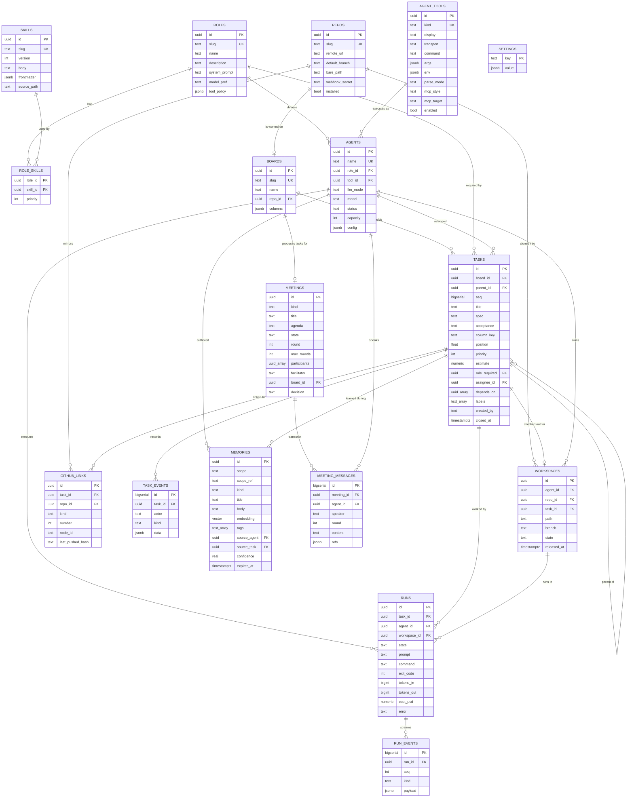

# iofi — Data Model

Source of truth: `internal/store/migrations/`. This document explains the shape
and the reasoning; the migrations are what actually runs.

PostgreSQL 17 with `pgcrypto` (UUID generation) and `pgvector` (memory search).
All primary keys are `uuid` defaulting to `gen_random_uuid()`, except the
append-only logs, which use `bigserial` because they are read in insertion order.

---

## 1. Entity relationship diagram

`SETTINGS` and `SCHEMA_MIGRATIONS` stand alone — key/value stores with no
relationships, so they carry no edges above.

---

## 2. Tables

### 2.1 Organisation

**`roles`** — a job in the company.

`tool_policy` is `{"allow": [...], "deny": [...]}`. An empty `allow` means
everything not denied. It is evaluated when an MCP server is built for a run, so
a forbidden tool is not merely rejected — it is never advertised to the model.
A tool the agent cannot see is a tool it cannot be tempted to hallucinate.

**`skills`** — a reusable markdown procedure.

`body` is the markdown after the frontmatter; `frontmatter` keeps the parsed
YAML (`applies_to`, `tools_required`, `priority`, `description`). Rows are
mirrored from `skills/*.md` at boot and are also editable from the console, so
`source_path` records which file a skill came from, or is empty when authored in
the browser.

**`role_skills`** — many-to-many, ordered by `priority` (lowest first). One role
has many skills; one skill serves many roles. When a role has more skills than
fit the prompt budget, the coordinator narrows the set and `priority` is the
fallback ordering.

**`agent_tools`** — one row per coding CLI.

This is the table that makes FR-2 true. `command` and `args` are templated with
`{{.Prompt}}`, `{{.Workspace}}`, `{{.MCPConfig}}`, `{{.Model}}`, `{{.RunID}}`.
`parse_mode` selects the output normaliser (`claude_stream_json`, `jsonl`,
`plain`). `mcp_style` and `mcp_target` describe how that CLI is told where iofi's
MCP endpoint is: a command-line flag, a config file at a path, or environment.
`transport` is `spawn` (run the CLI, read stdout) or `mcp_client` (the tool
itself is an MCP server exposing an agent turn; iofi calls it).

**`agents`** — a named worker: one role, one tool.

`capacity` bounds concurrent runs. `llm_mode` is `native` (the CLI's own
subscription login) or `proxy` (point the CLI at LiteLLM). `config` carries
per-agent overrides, including `env.NAME` keys that win over the defaults iofi
injects.

`role_id` and `tool_id` are `ON DELETE RESTRICT`: deleting a role that agents
still hold should fail loudly, not orphan them.

### 2.2 Work

**`repos`** — a connected GitHub repository. `bare_path` is the local bare
clone; `installed` flips once it exists. `webhook_secret` is per repository, and
its absence causes deliveries to be refused.

**`boards`** — a kanban. `columns` is an ordered JSON array of
`{key, name, wip}`. Columns live in the board row rather than a separate table:
they are always read and written as a whole, and a `columns` table would add a
join to every board load for no query anyone runs.

`repo_id` is the binding that makes real work possible — without it, agents on
this board get a scratch directory instead of a worktree.

**`tasks`** — the unit of work.

`seq` is a `bigserial` used as the human-facing number; the UUID stays the
identity. `position` is a float so a card can be reordered between two others
without renumbering the column. `depends_on` is a `uuid[]` rather than a join
table: dependencies are read with the task and never queried independently.

`spec` is what to do; `acceptance` is how anyone knows it was done. Both are
handed to the agent verbatim.

**`task_events`** — the audit trail. `actor` is `founder`, `agent:<id>`,
`github` or `brain`. Every state change, comment, handoff and routing rationale
lands here. It is append-only and is what makes a wrong decision reviewable
rather than merely visible.

### 2.3 Execution

**`workspaces`** — a git worktree, or a scratch directory for roles with no
repository. One per agent per task. `released_at` marks it reclaimed;
`ListWorkspaces` returns only live ones.

Worktrees are released when the task closes, not when the run ends — the branch
still has to be reviewed. Scratch directories are released immediately.

**`runs`** — one execution of one agent.

`prompt` is the fully composed brief, kept so a run can be understood after the
fact. `command` is the rendered command line. `tokens_in`/`tokens_out`/`cost_usd`
accumulate as usage events arrive. `agent_id` is `ON DELETE CASCADE`: firing an
agent takes its history with it.

**`run_events`** — the normalised output stream, `seq`-ordered per run. Kinds:
`text`, `tool_call`, `tool_result`, `usage`, `error`, `done`. This is the same
data the browser receives live over SSE, persisted so a finished run can be
replayed. A janitor prunes events of finished runs past the retention window;
live runs are never truncated under themselves.

### 2.4 Knowledge

**`memories`** — what the company knows.

`scope` plus `scope_ref` gives four visibilities: `global` (everyone),
`role:<id>`, `project:<id>` (a board), `agent:<id>`. `kind` is `fact`,
`decision`, `convention`, `pitfall` or `artifact`.

`embedding` is `vector(1536)`, indexed HNSW with cosine distance. Search ranks by
`(1 - distance) × confidence`, so a near-match nobody trusts does not outrank a
slightly worse match that was recorded as settled. When no embedding provider is
configured the query degrades to `ILIKE` — memory has to work before an API key
exists.

`expires_at` lets an agent record something temporary without polluting the
corpus forever; expired rows are hidden from search and deleted by the janitor.

### 2.5 Collaboration

**`meetings`** — a bounded discussion. `state` walks
`open → agenda → round → resolve → decided → closed`; `round` and `max_rounds`
guarantee termination. `participants` is a `uuid[]` of agents. `board_id` is
where any tasks the decision produces will land.

**`meeting_messages`** — the transcript, `bigserial`-ordered so a client can poll
with `since_id`. `speaker` is a display name (`Founder`, `facilitator`, or the
agent's name) and `agent_id` is null for the first two.

### 2.6 Integration

**`github_links`** — the mapping between a task and an issue or pull request,
unique on `(repo_id, kind, number)`.

`last_pushed_hash` is the loop guard. Every outbound write stores a hash of the
state it pushed; an inbound webhook whose payload hashes to the same value is
dropped as our own echo. Without it, each side keeps answering the other.

**`settings`** — key/value JSON. Currently holds `token_prices`, the operator's
rate table used to cost runs from tools that report tokens but not money.

---

## 3. Deletion behaviour

| Relationship | On delete | Reasoning |
|---|---|---|
| `agents.role_id`, `agents.tool_id` | RESTRICT | Deleting a role or tool still in use must fail visibly |
| `tasks.board_id` | CASCADE | A board's tasks have no meaning without it |
| `tasks.role_required`, `tasks.assignee_id`, `tasks.parent_id` | SET NULL | Losing a role or agent should not delete the work |
| `task_events.task_id`, `run_events.run_id`, `meeting_messages.meeting_id` | CASCADE | Logs belong to their subject |
| `runs.agent_id` | CASCADE | Firing an agent removes its history |
| `runs.task_id`, `runs.workspace_id` | SET NULL | A run is still a record of spend after its task is gone |
| `memories.source_agent`, `memories.source_task` | SET NULL | Knowledge outlives whoever discovered it — this is the point of shared memory |
| `github_links.*` | CASCADE | A link to a deleted task or repo is meaningless |
| `workspaces.agent_id` | CASCADE | A workspace with no owner cannot be reclaimed |

## 4. Indexes

Beyond primary and unique keys:

| Index | Serves |
|---|---|
| `tasks(board_id, column_key, position)` | Rendering a board column in order |
| `tasks(assignee_id)`, `tasks(role_required)` | "my tasks", "tasks for my role" |
| `task_events(task_id, id)` | Task activity timeline |
| `agents(role_id)`, `agents(status)` | Picking an agent for a role |
| `runs(agent_id, created_at DESC)`, `runs(task_id)` | Run history, cost report |
| `run_events(run_id, seq)` | Replaying a run in order |
| `memories(scope, scope_ref)` | Scope filtering before vector search |
| `memories USING gin(tags)` | Tag filtering |
| `memories USING hnsw(embedding vector_cosine_ops)` | Semantic search |
| `workspaces(agent_id)` | Live workspace listing |
| `github_links(task_id)` | Finding a task's issue when pushing |

## 5. Migrations

Applied in filename order at boot, each in its own transaction, recorded in
`schema_migrations`. Forward-only by decision: every migration would otherwise
need a hand-written inverse that is almost never run. Roll back by restoring the
database.

| File | Contents |
|---|---|
| `0001_init.sql` | Extensions, all tables, indexes |
| `0002_seed.sql` | Four coding tools, ten roles with their system prompts, the default board |
| `0003_command_code.sql` | CommandCode's verified CLI flags; enables the row |

## 6. Testing

`internal/store/store_test.go` runs every query against a real PostgreSQL with
pgvector, and skips when `IOFI_TEST_DATABASE_URL` is unset. There is nothing
worth mocking: what breaks in this layer is the SQL, the jsonb casts and the
array types, and a mock reproduces none of them. CI provides the database on
every push.
