# iofi — Flows

How the system actually behaves, end to end. Each flow names the code that
implements it. Companion documents: [PRD](PRD.md), [ERD](ERD.md),
[ARCHITECTURE](ARCHITECTURE.md).

---

## 1. Boot

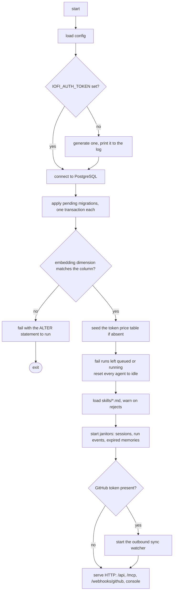

Step **H** matters more than it looks. Nothing can resume a coding CLI whose
parent process died. Skipping it leaves agents permanently `busy`, and
`PickAgentForRole` then treats the whole company as full — the system looks
alive and accepts no work.

`cmd/iofi/main.go`, `internal/store/maintenance.go`

---

## 2. Founder intake → dispatch

The core loop. The Founder writes what they want; iofi decides the rest.

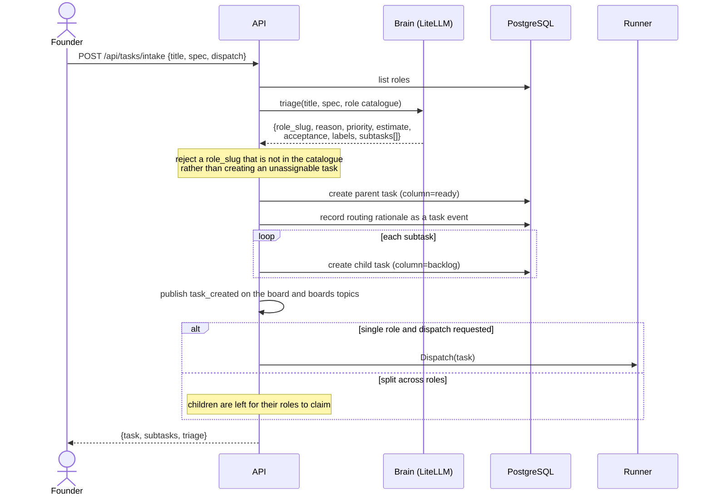

The rationale is stored, not just the choice. A routing decision nobody can
review is a routing decision nobody can correct.

`internal/api/handlers.go:intake`, `internal/brain/coordinator.go`

---

## 3. Run lifecycle

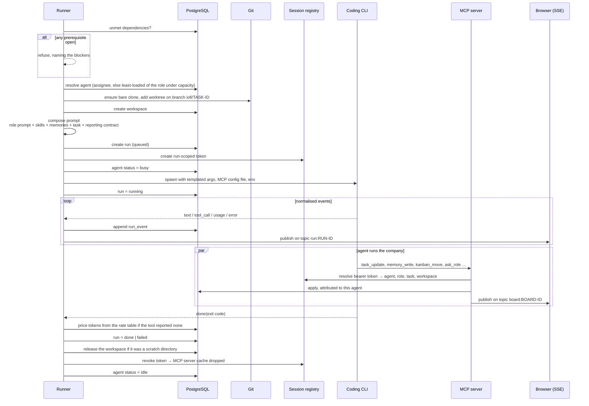

Two guards worth naming:

- **Dependencies** are checked before anything is created. An agent cannot know
  from its brief that a prerequisite is unfinished, so the check belongs here.
- **Token revocation** also drops the cached MCP server behind it. Without that,
  every run leaks a server for the process's lifetime.

`internal/runner/runner.go`, `internal/runner/adapter.go`, `internal/mcpsrv/`

---

## 4. Agent adapters

One interface, two transports, and a third case that needs no Go at all.

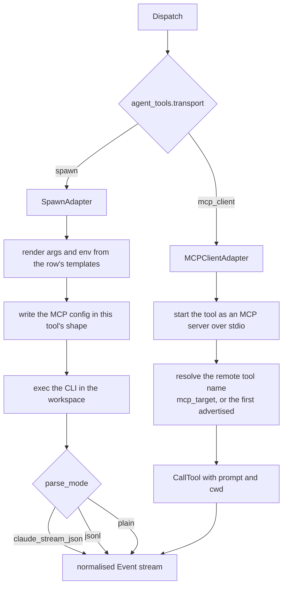

Every tool collapses into the same `Event` stream — `text`, `tool_call`,
`tool_result`, `usage`, `error`, `done` — so the database and the console never
learn a tool-specific format.

The MCP config shape differs per tool and is the easiest thing to get silently
wrong: a mis-keyed entry means the server is ignored and the agent runs with no
iofi tools at all, which looks like the agent simply choosing not to use them.

| Tool | Config location | Shape |
|---|---|---|
| Claude Code | `--mcp-config <file>` | `mcpServers.iofi.type = "http"` |
| Codex | `$CODEX_HOME/config.toml` | `[mcp_servers.iofi]` with `url`, `bearer_token` |
| OpenCode | `opencode.json` | `mcp.iofi.type = "remote"`, `enabled` |
| CommandCode | `.mcp.json` in the project root | `mcpServers.iofi.transport = "http"`, `enabled` |

Adding a fifth tool is a row: command, args, parse mode, config style, config
target. No Go changes.

`internal/runner/adapter.go`, `internal/runner/mcpclient.go`

---

## 5. Prompt composition

What an agent actually receives.

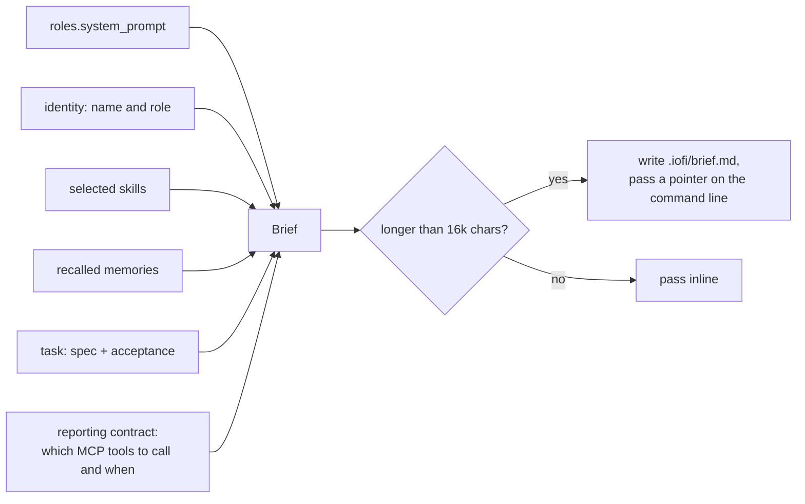

**Skill selection.** All of the role's skills if they fit the budget; otherwise
the coordinator picks the ones whose *When To Use* matches the task, falling back
to `role_skills.priority` order if that call fails. A failed narrowing must not
fail the run.

**Memory recall.** The task title and spec are embedded and searched across
`global`, `role:<id>` and `project:<board>`, ranked by similarity weighted by
confidence. The agent does not have to ask — the eight most relevant items are
already in the brief, and it can call `memory_search` for more.

`internal/runner/prompt.go`

---

## 6. MCP: authentication and tool filtering

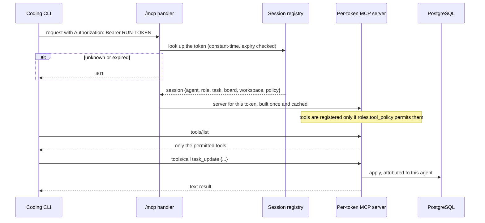

Filtering happens at registration, not at call time. A tool the role cannot use
is never advertised — the model cannot be tempted by a capability it never sees,
and a refusal never wastes a turn.

Tokens carry the task and workspace, so `task_update` with no arguments means
"the task I was dispatched for". The agent cannot act on another agent's task by
omission.

`internal/mcpsrv/server.go`, `internal/session/session.go`

---

## 7. Kanban guards

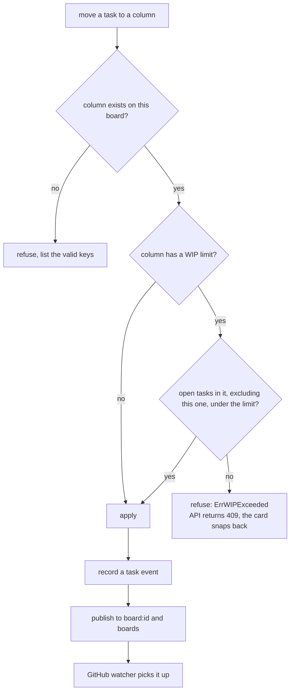

The count excludes the task being moved, so a move within the same column never
trips its own limit. The check lives in `store.UpdateTask`, so both callers —
the console and the agents' `kanban_move` — are covered by one guard rather than
two that can drift.

`internal/store/kanban.go`

---

## 8. Meeting

Not free chat. A facilitator drives a state machine with a hard round cap.

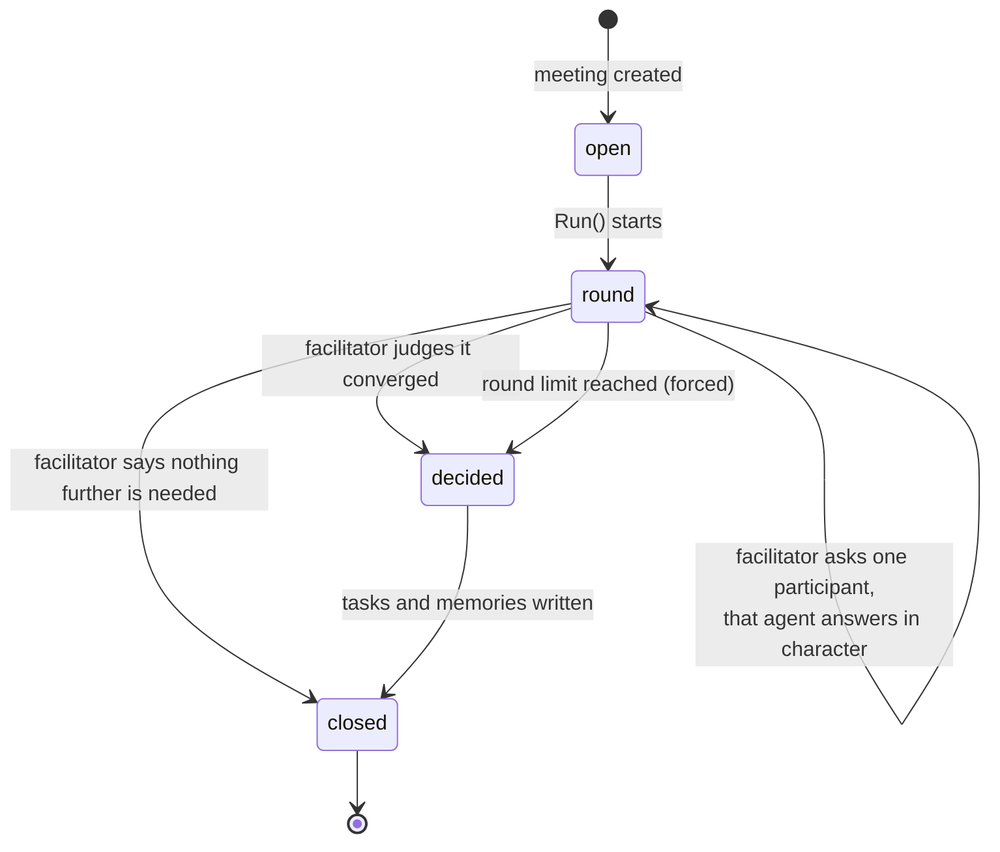

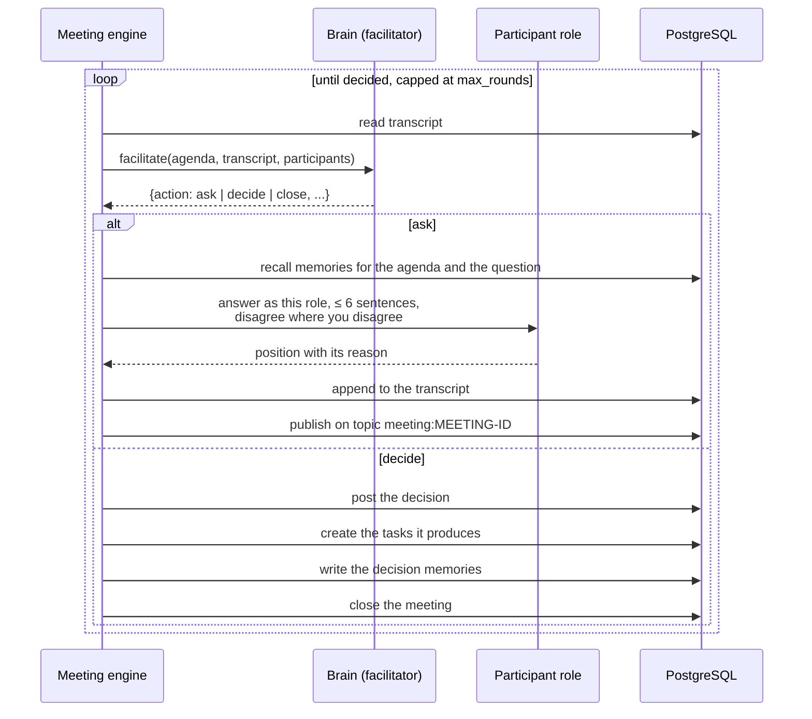

Three deliberate choices:

- **Participants speak through the coordinator model, not their coding CLI.** A
  meeting is talking, not building; spawning four CLIs to hold a conversation
  would cost a hundred times more and produce the same words.
- **The round cap forces a decision.** A discussion that has not converged is
  decided on what was said rather than left open forever.
- **Agreement ends the meeting.** The facilitator is told that agreement is a
  reason to decide, not to run another round — otherwise agents restate each
  other politely until the token budget is gone.

A meeting opened by an agent through `meeting_open` is facilitated immediately
in the background. An unfacilitated room stays empty forever.

`internal/meeting/engine.go`, `internal/brain/coordinator.go`

---

## 9. GitHub two-way sync

### Outbound

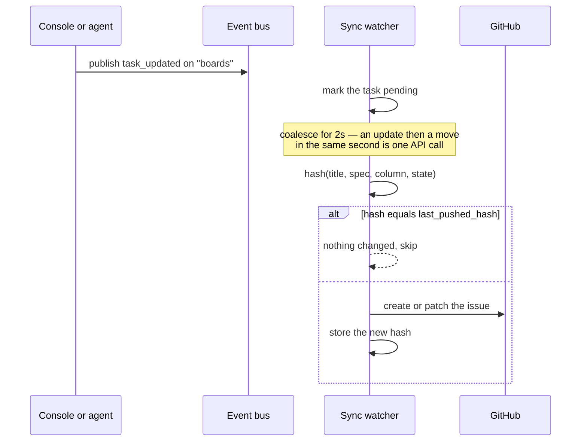

### Inbound

```mermaid
sequenceDiagram
    participant GH as GitHub
    participant H as /webhooks/github
    participant DB as PostgreSQL

    GH->>H: POST with X-Hub-Signature-256
    H->>DB: find the repository by full_name
    alt no secret configured for it
        H-->>GH: 401 — fails closed
    end
    H->>H: verify HMAC-SHA256, constant-time
    alt signature invalid
        H-->>GH: 401
    end
    H->>H: hash the incoming state
    alt hash equals last_pushed_hash
        H-->>GH: 204 — this is the echo of our own push
    end
    alt issues
        H->>DB: create or update the task, set the column from its iofi:COLUMN label
    else issue_comment
        H->>DB: append a task event
    else pull_request
        H->>DB: merged → done and closed; closed → blocked; otherwise review
    end
```

The loop guard is the whole design. Every outbound write stores a hash of what
it pushed; an inbound event hashing to the same value is dropped. Without it,
each side answers the other's echo and the two never settle.

Failing closed on a missing secret is deliberate: an unverified webhook can
create tasks, move the board and close work, and "no secret" is far more often an
oversight than a choice. A repository that genuinely wants unsigned deliveries
sets its secret to `insecure-no-verification`.

`internal/github/sync.go`

---

## 10. Pull request

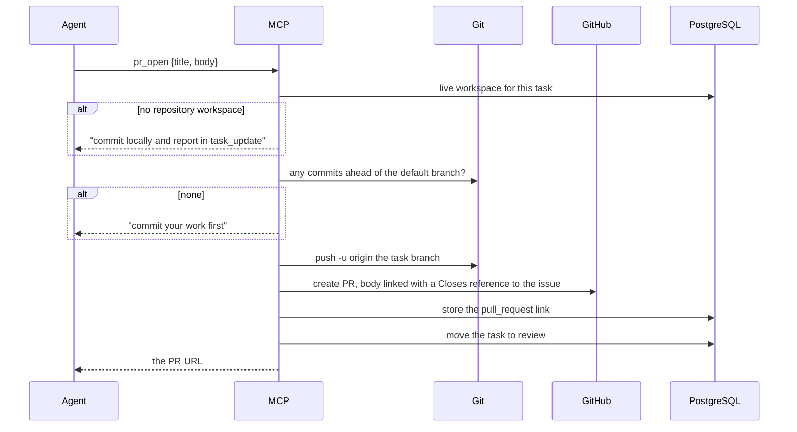

Both refusals are messages the agent can act on, not stack traces. An agent told
"commit your work first" commits; an agent shown a git error guesses.

---

## 11. Shared memory

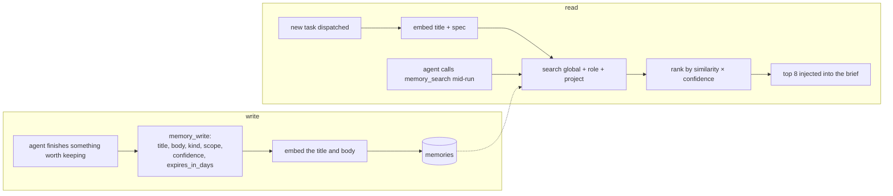

Confidence weights the ranking so a near-match nobody trusts does not outrank a
slightly worse match recorded as settled. With no embedding provider configured,
search degrades to keyword matching rather than returning nothing — memory has to
work before an API key exists.

`internal/store/knowledge.go`, `internal/runner/prompt.go`

---

## 12. Workspace lifecycle

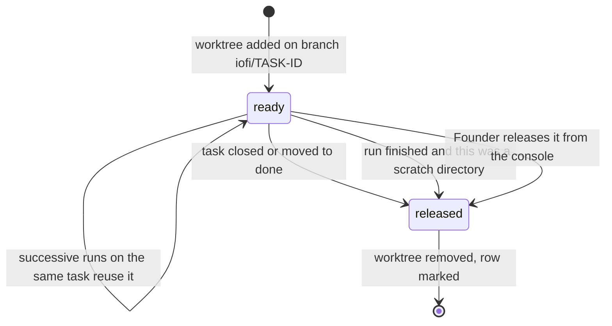

Repository worktrees survive the run that created them — the branch still has to
be reviewed, and deleting it at run end would throw away work in flight. They are
reclaimed when the task closes. Scratch directories, which have no branch and
nothing to review, go immediately.

`internal/runner/runner.go:ReleaseTaskWorkspaces`

---

## 13. Live updates

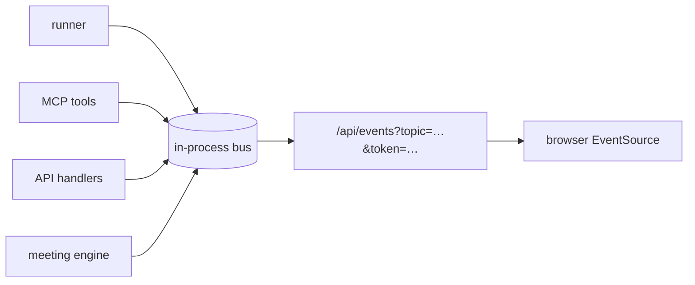

Topics: `run:<id>`, `board:<id>`, `boards`, `runs`, `meetings`,
`meeting:<id>`, `memory`, and `*` for everything.

Server-Sent Events rather than WebSockets, because the traffic is entirely
server-to-browser. `EventSource` cannot set headers, so the access token travels
as a query parameter on this one route.

Publishing never blocks: a subscriber that cannot keep up drops messages rather
than stalling the agent run that is producing them. A browser that falls behind
refetches; an agent that stalls loses work.

`internal/bus/bus.go`, `internal/api/sse.go`

---

## 14. Failure handling

| Failure | Behaviour |
|---|---|
| Coordinator (LiteLLM) unreachable | Intake and meetings fail with the error. Runs still dispatch: skill selection falls back to priority order and memory recall to keyword search. The console shows a coordinator-offline warning. |
| Embedding provider unavailable | Memories are stored without an embedding; search falls back to keyword matching. |
| Coding CLI missing or exits non-zero | Run marked `failed` with stderr's last decisive lines; agent returns to idle. |
| Agent exceeds two hours | Context deadline cancels the process; the run is marked failed. |
| iofi restarts mid-run | Boot fails the orphaned runs with that reason and resets every agent to idle. |
| Two agents claim one task | `ClaimTask` is a conditional update; exactly one wins, the loser is told it was already claimed. |
| Column at its WIP limit | Move refused, 409, the reason shown. |
| Prerequisite still open | Dispatch refused, blockers named. |
| Webhook without a secret | Rejected, logged. |
| GitHub API error on an automatic push | Logged and skipped; the next change to that task retries, since the stored hash was not updated. |
